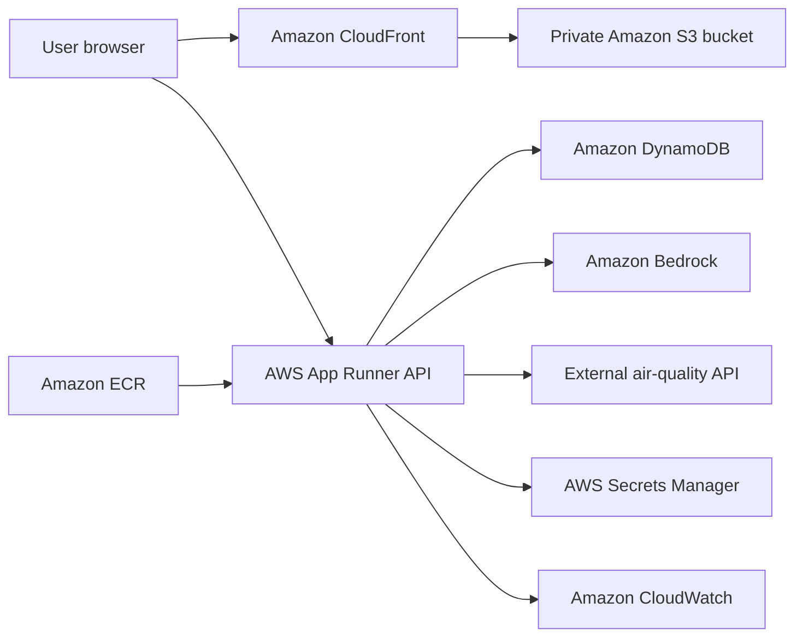

# SmogWise

A GenAI-powered assistant that helps families and communities navigate severe winter smog and urban air pollution. SmogWise recommends lower-emission daily routines, practical indoor-air improvements, and sustainable alternatives based on the user's location, household needs, and lifestyle. It also explains the estimated effect of each recommendation in plain language.

## Challenge Vertical

**Climate resilience, public health, and sustainable urban living**

The project addresses severe winter smog and urban air pollution. It focuses on practical actions that users can take without requiring specialist knowledge or expensive equipment.

## Problem Statement

During severe winter smog, families often receive generic advice that does not account for local air quality, daily schedules, health sensitivities, available transport, housing conditions, or budget. Users also struggle to understand how individual choices affect personal exposure and local emissions.

SmogWise converts air-quality and lifestyle context into a safe, realistic daily plan. It helps users:

- Reduce exposure during high-pollution hours.
- Replace high-emission activities with cleaner alternatives.
- Improve indoor air quality using affordable measures.
- Protect children, older adults, pregnant people, and people with respiratory or cardiovascular conditions.
- Understand the expected impact and trade-offs of each action.

> SmogWise provides general environmental-health guidance and is not a substitute for medical advice. Users with symptoms or existing health conditions should follow local health-authority guidance and consult a qualified clinician.

## Core Features

### Location-aware air-quality guidance

- Uses the user's permission-based location or a manually entered city.
- Retrieves current AQI, major pollutants, weather conditions, and available forecasts.
- Shows the data source and the time at which the reading was updated.
- Never asks the language model to invent live AQI values.

### Personalized daily routines

Recommendations consider seven household inputs, defined in
[`backend/src/schemas.ts`](backend/src/schemas.ts):

- Commute method: car, motorbike, public transport, walking, cycling, or working from home.
- Daily minutes spent outdoors.
- Age groups present in the household.
- Respiratory or cardiovascular sensitivity, pregnancy, or an adult over 65.
- Cooking fuel, including biomass and other solid fuels.
- Whether the household owns an air purifier.
- Budget for changes.

Not inputs, despite being natural things to ask for: commute or school
*schedule*, household size, and heating method. The app has no time-of-day
field, so it cannot tailor advice to when someone actually travels. `budget`
currently only distinguishes `low` from the rest.

Example suggestions include changing outdoor activity times, choosing lower-traffic routes, combining errands, using public transport or carpooling, avoiding waste burning, and ventilating the home when outdoor pollution is lower.

### Indoor air-quality assistance

- Ventilation timing based on outdoor conditions.
- Kitchen exhaust and clean-cooking suggestions.
- Guidance for reducing indoor smoke, dust, incense, and candle use.
- Affordable filtration and purifier-maintenance tips.
- Room-priority advice when the household has limited filtration capacity.

### Impact explanations

Each suggestion explains:

- **What to do**
- **Why it is recommended**
- **Expected personal benefit**, such as lower exposure
- **Expected community benefit**, such as fewer vehicle emissions
- **Cost and effort level**
- **Confidence and data limitations**

Impact statements describe a mechanism and a direction, each with an evidence
rating of well established, reasonably supported, or limited. They are
reviewed prose, not calculations: there is no emission factor or arithmetic
anywhere in the codebase, and no percentage is claimed. A test asserts that no
catalogue entry contains one.

That is a deliberate limit and also a real gap. Saying "roughly in proportion
to the time you avoid" is honest but less useful than a cited reference factor
would be. Adding quantified impact means sourcing defensible factors per
action, which is research this project has not done.

### Community mode

- Reusable clean-air checklists for schools, housing societies, and neighborhood groups.
- Community actions such as no-idling zones, shared transport, dust reporting, and safe communication during pollution peaks.
- Shareable summaries that exclude private household and health information.

## Approach and Decision Logic

SmogWise uses a hybrid approach so that safety does not depend only on a language model.

1. The user provides location and optional lifestyle preferences.
2. The backend retrieves current air-quality data from a trusted external provider.
3. A deterministic rules engine assigns a risk band using pollutant values and local AQI guidance.
4. The rules engine creates safety constraints for the user's risk group.
5. Amazon Bedrock generates a clear, personalized plan using only the supplied context and approved recommendation catalogue.
6. The backend validates the generated response against a structured schema and safety rules.
7. The UI displays recommendations, source timestamps, reasons, estimated impact, and uncertainty.

### Example decision rules

- If pollution is severe, avoid recommending strenuous outdoor exercise.
- If the user belongs to a sensitive group, apply stricter exposure thresholds.
- If indoor cooking produces smoke, prioritize exhaust ventilation and cleaner cooking methods.
- If the user cannot change commute time, suggest a lower-exposure route and a well-fitted protective mask where local guidance supports it.
- If live data is unavailable or stale, state that clearly and provide only general precautions.

## Responsible GenAI Design

- Live environmental facts come from APIs, not model memory.
- The model receives the minimum context required for a recommendation.
- Structured outputs are validated before they reach the user.
- High-risk health advice is controlled by deterministic rules.
- Prompt-injection-like text from external data is treated only as data.
- The app does not diagnose disease or recommend medication.
- User location and health preferences are optional and collected with clear consent.
- Sensitive data is not written to application logs.
- Stored profiles can be viewed and deleted by the user.

## Live deployment

| | URL |
|---|---|
| **Web app** | https://d1lae1x52oxefj.cloudfront.net |
| **API** | https://yzjmcnk4t4.us-east-1.awsapprunner.com |
| API health | https://yzjmcnk4t4.us-east-1.awsapprunner.com/health |

Frontend on CloudFront over a private S3 bucket, backend on AWS App Runner,
accounts and the reading cache in DynamoDB, in `us-east-1`.

Verified against the running deployment:

| Check | Result |
|---|---|
| API health | `{"status":"ok"}` |
| Live reading | US AQI 181, banded "Unhealthy", 24-hour outlook returned |
| Account creation | HTTP 201, session cookie set |
| Authenticated plan | 6 recommendations, escalated unhealthy → very unhealthy for a sensitive household |
| Anonymous plan request | 401, as intended |
| CORS from CloudFront | Allowed, echoing that exact origin |
| CORS from another origin | 403 |
| Client-side routes `/login`, `/privacy`, `/dashboard` | 200, each served from a published copy of the app shell |
| API through the site origin | `/api/*` is proxied by CloudFront, so the page and the API are one site and the session cookie is sent |
| Request refused by the API | Keeps its real status through CloudFront (403 without a CSRF token, 404 for an unknown endpoint) |
| Security headers | HSTS, CSP, `X-Frame-Options: DENY`, `X-Content-Type-Options: nosniff` |

> Running this costs money. App Runner bills continuously at `MinSize: 1`
> whether or not anyone visits. Teardown commands are in
> [`infrastructure/README.md`](infrastructure/README.md).

## Current Status

**All three phases are complete and deployed.** 537 tests pass with enforced coverage floors, lint and type checks are clean, both projects build, five CloudFormation templates validate, and the stack is live on AWS. What remains needs a human: a manual screen-reader pass, real-device testing, and the demo video. Those are listed explicitly in [Phase 3](#phase-3-product-polish-validation-and-submission--code-complete) and [`docs/limitations.md`](docs/limitations.md).

| Area | State |
|---|---|
| Landing page | Built, with a framed live product preview |
| Dashboard | Built, three-step indicator, stat cards, 24-hour outlook chart |
| Privacy page | Built, every claim linked to the code behind it |
| Saved plans | Built, device-local with user-controlled deletion |
| Community checklist | Built, household and health details stripped |
| React frontend | 254 tests passing, 94% statement coverage |
| Node.js API | 283 tests passing, 85% statement coverage |
| 24-hour outlook | Names the cleanest and worst hours ahead, so "shift your outdoor time" is actionable |
| Live air-quality data | Working against Open-Meteo, no API key required |
| Risk and recommendation rules | Complete, verified over 1,000+ household and band combinations |
| Amazon Bedrock | **Live**, using `amazon.nova-pro-v1:0`. Rewords reviewed advice; validated and bounded |
| Accounts | Email and scrypt-hashed password, signed httpOnly session cookie |
| Amazon DynamoDB | User accounts plus the air-quality cache with TTL |
| Container image | Dockerfile builds, multi-stage, non-root |
| AWS infrastructure | 5 CloudFormation templates, all passing `cfn-lint` |
| CI/CD | 3 workflows, 8 jobs, OIDC, dependency + container + secret scanning |
| Deployed to AWS | **Live.** Backend on App Runner, frontend on CloudFront, verified end to end |

### Documentation

| Document | Covers |
|---|---|
| [`docs/architecture.md`](docs/architecture.md) | System shape, request flow, the rules-over-model decision, caching, where data lives |
| [`docs/limitations.md`](docs/limitations.md) | What is unverified, deliberate constraints, accuracy caveats, testing boundaries |
| [`infrastructure/README.md`](infrastructure/README.md) | Deployment runbook, security decisions, teardown |
| [`backend/README.md`](backend/README.md) | API reference, risk model, environment variables |
| [`frontend/README.md`](frontend/README.md) | Structure, accessibility, privacy |

> **Before deploying:** AWS closed App Runner to new customers on 30 April 2026. If your account did not use App Runner before that date, `04-backend.yaml` will not deploy. The runbook includes a one-command eligibility check and the alternative AWS recommends. Details in [`infrastructure/README.md`](infrastructure/README.md).

## Running It Locally

Requires Node.js 22 or later. No AWS account or API key is needed for the core experience.

```bash
# Terminal 1: the API
cd backend
npm install
npm run dev            # http://localhost:3000

# Terminal 2: the web app
cd frontend
npm install
npm run dev            # http://localhost:5173
```

Open http://localhost:5173 for the landing page, then follow "Check my air now" to the dashboard at `/dashboard`, search for a city, and generate a plan.

To enable Bedrock personalisation, copy `backend/.env.example` to `backend/.env`, set `BEDROCK_MODEL_ID` and `AWS_REGION`, and make AWS credentials available through the standard provider chain. Without it the service runs on the deterministic rules engine and reports `generatedBy: "rules"`.

### Checks

```bash
cd backend  && npm run typecheck && npm test && npm run build && npm audit
cd frontend && npm run lint && npm run typecheck && npm test && npm run build && npm audit

# Infrastructure templates
pip install cfn-lint && cfn-lint

# Container image
docker build -t smogwise-api:local ./backend
```

On Windows, [`verify.ps1`](verify.ps1) runs all of the above except the container build and prints one summary:

```powershell
powershell -ExecutionPolicy Bypass -File .\verify.ps1
```

The same checks run in CI on every push, across eight jobs that add Trivy image scanning and a Gitleaks scan of full history.

## Pages

| Route | Auth | Purpose |
|---|---|---|
| `/` | — | Landing page: what the product does, how it works, a live example reading, and the safety model |
| `/login` | — | Sign in or create an account, two modes on one page |
| `/privacy` | — | What the app does with each piece of data, with links to the code that backs each claim |
| `/dashboard` | **required** | The working tool: location, household details, 24-hour outlook, and the generated plan |

Published air-quality data stays public, so the landing page can show a live
reading to anyone. The dashboard needs an account because it is where household
and health answers are entered.

Client-side routing means a deep link such as `/dashboard` is not a file in S3. CloudFront is configured to serve the app shell for 403 and 404 so React Router can render the route. That trade-off and its mitigation are documented in [`infrastructure/05-frontend.yaml`](infrastructure/05-frontend.yaml).

## Technology Stack

| Layer | Technology | Purpose |
|---|---|---|
| Frontend | React 19, TypeScript, Vite | Accessible responsive web application |
| Styling | Hand-written CSS with custom properties | Full control over contrast and forced-colours support, no framework weight |
| Backend | Node.js 22, TypeScript, Express 5 | API, validation, recommendation orchestration |
| Validation | Zod | Request and model-output schema validation |
| GenAI | Amazon Bedrock (Converse API) | Rewords reviewed recommendations for the household |
| Database | Amazon DynamoDB | User accounts and the air-quality cache. Saved plans stay in the browser by design |
| Air-quality data | [Open-Meteo](https://open-meteo.com/) Air Quality and Geocoding APIs | Current pollutant readings and city search, no API key required |
| Frontend hosting | Amazon S3 | Stores the production React build |
| Content delivery | Amazon CloudFront | Delivers the frontend over HTTPS and caches static assets |
| Backend hosting | AWS App Runner | Runs and scales the Node.js API |
| Container registry | Amazon ECR | Stores the backend container image for App Runner |
| Monitoring | Amazon CloudWatch | Application logs, metrics, dashboards, and alarms |
| Testing | Vitest, React Testing Library, Supertest, axe-core | Unit, component, API, and accessibility tests |
| CI/CD | GitHub Actions | Linting, tests, builds, and deployments |

Air-quality provider note: Open-Meteo was chosen because it serves both geocoding and current air quality without an API key, which removes a credential from the deployment entirely. Risk bands are computed from the US EPA Air Quality Index rather than taken on trust, and the European index is displayed alongside it with an explicit note that the two scales are not interchangeable.

## AWS Architecture



### AWS services needed for the MVP

1. **Amazon S3**  
   CloudFront distributes the frontend, but S3 stores the compiled React files. Keep the bucket private and allow access only through CloudFront Origin Access Control.

2. **Amazon CloudFront**  
   Provides HTTPS, caching, compression, and global delivery for the frontend.

3. **AWS App Runner**  
   Deploys and automatically scales the Node.js backend. Configure health checks and an App Runner instance role with only the DynamoDB, Bedrock, Secrets Manager, and CloudWatch permissions the application needs.

4. **Amazon ECR**  
   Stores the backend Docker image consumed by App Runner. This is needed when using App Runner's container-image deployment option.

5. **Amazon DynamoDB**  
   Stores consented user preferences, saved recommendations, and optional short-lived AQI cache entries. Enable point-in-time recovery for production data.

6. **Amazon Bedrock**  
   Generates personalized routines and plain-language explanations. Model access must be enabled in the selected AWS Region.

7. **AWS Identity and Access Management (IAM)**  
   Provides least-privilege roles for App Runner, CI/CD, S3 deployment, DynamoDB access, and Bedrock invocation.

8. **Amazon CloudWatch**  
   Collects backend logs and metrics. Configure alarms for elevated error rates, latency, and App Runner failures.

9. **AWS Secrets Manager**  
   Stores the external air-quality API key and other server-side secrets. No secret should be included in React code, source control, or logs.

### Recommended production services

- **AWS Certificate Manager (ACM):** Free managed TLS certificate for a custom domain used by CloudFront.
- **Amazon Route 53:** DNS management for the frontend and API domains.
- **AWS WAF:** Rate limiting and protection from common web attacks. Attach it to CloudFront.
- **Amazon Cognito:** Add only if user accounts, cross-device profiles, or private saved plans are required.
- **AWS CloudTrail:** Audit AWS account and API activity.
- **AWS Budgets:** Cost alerts for Bedrock, App Runner, DynamoDB, and data transfer.

### Optional services for later versions

- **Amazon Location Service:** Geocoding when users enter an address or locality. Browser geolocation is sufficient when only coordinates are needed.
- **Amazon EventBridge and AWS Lambda:** Periodically refresh shared AQI cache entries or send scheduled pollution alerts.
- **Amazon SNS:** Opt-in SMS or email alerts. Obtain explicit consent and provide an unsubscribe mechanism.
- **Amazon API Gateway:** Useful when the project needs centralized API quotas, API keys, or additional gateway controls. It is not required for the MVP because App Runner already exposes an HTTPS endpoint.

## Suggested DynamoDB Design

Use a single table with partition and sort keys where practical.

| Entity | Partition key | Sort key | Notes |
|---|---|---|---|
| User preferences | `USER#<userId>` | `PROFILE` | Store only consented fields |
| Saved plan | `USER#<userId>` | `PLAN#<timestamp>` | Add retention or deletion controls |
| AQI cache | `LOCATION#<geohash>` | `AQI#<timestamp>` | Use DynamoDB TTL for expiry |
| Community checklist | `COMMUNITY#<id>` | `CHECKLIST#<id>` | Exclude private health information |

## API Outline

| Method | Endpoint | Purpose | Status |
|---|---|---|---|
| `GET` | `/health` | App Runner health check | Built |
| `GET` | `/api/locations` | City search by name | Built |
| `GET` | `/api/air-quality` | Return normalized AQI and source metadata | Built |
| `POST` | `/api/recommendations` | Generate a personalized, validated daily plan | Built |

Saved-plan endpoints were planned and deliberately not built. A plan summary
can disclose that someone in the household is medically sensitive, so plans
stay in browser local storage and never reach a server. The
`USER#<userId>`/`PLAN#<timestamp>` and `COMMUNITY#<id>` key designs above are
therefore unused: DynamoDB holds accounts and the air-quality cache only.

All write endpoints validate input, limit payload size, and enforce rate limits. The plan endpoint requires a signed-in session. See [`backend/README.md`](backend/README.md) for request and response shapes.

## Security Measures

- Keep S3 private and use CloudFront Origin Access Control.
- Store secrets in Secrets Manager and rotate them when supported.
- Give the App Runner instance role only the required resource actions.
- Encrypt traffic with HTTPS and data at rest with AWS-managed encryption or customer-managed KMS keys where required.
- Restrict CORS to the deployed frontend origin.
- Validate and normalize every API request.
- Apply request-size limits and rate limiting, both per client address and per account on the login route, so an attacker with many addresses still cannot grind one account.
- Require a double-submit CSRF token and a matching origin on every state-changing request.
- Redact precise locations, health preferences, tokens, and API keys from logs.
- Pin dependencies, run dependency scanning, and keep the base container image updated.
- Avoid storing exact coordinates unless the feature requires them and the user consents.

## Accessibility

- Meet WCAG 2.2 AA color contrast targets.
- Do not communicate AQI severity through color alone; include text and icons.
- Support keyboard navigation and visible focus states.
- Use semantic HTML, descriptive labels, and screen-reader announcements for updated AQI results.
- Respect reduced-motion preferences.
- Use plain language and support scalable text.
- Provide loading, empty, stale-data, offline, and error states.

## Efficiency

- Cache static frontend assets through CloudFront using content-hashed filenames.
- Cache location-level AQI results briefly to reduce external API calls while preserving freshness.
- Use DynamoDB on-demand capacity for an early-stage, unpredictable workload.
- Limit Bedrock prompt size and request structured JSON output.
- Generate a new AI response only when relevant context changes.
- Set API timeouts and retries with exponential backoff for transient upstream failures.
- Gzip API responses. A plan response goes from about 1,878 bytes to 575.
- Split the bundle by route, so a first visit to the landing page does not download the dashboard.

## Testing Strategy

- **Unit tests:** AQI normalization, risk bands, recommendation rules, impact calculations, and input schemas.
- **Component tests:** Forms, AQI status, recommendations, keyboard interactions, and error states.
- **API integration tests:** Valid and invalid requests, stale upstream data, Bedrock failures, and authorization.
- **Accessibility tests:** Automated checks with axe plus manual keyboard and screen-reader testing.
- **Security tests:** Secret scanning, dependency scanning, CORS checks, rate-limit checks, and authorization tests.
- **End-to-end tests:** Location selection through recommendation display and plan deletion.

## Assumptions

- The user explicitly permits location access or enters a city manually.
- The selected air-quality provider legally permits the intended usage and caching behavior.
- AQI scales differ by country, so the backend preserves the source scale and labels it clearly.
- Emission and exposure effects are estimates unless measured by a verified device or source.
- The first release is a web application and requires an internet connection for live recommendations.
- Authentication is optional for anonymous use and required only for private saved data.

## Three-Phase Implementation Plan

### Phase 1: Product Foundation and Local MVP — complete

**Goal:** Build a complete local user journey before deploying it to AWS.

#### Planning and design

- [x] Finalize the target users, supported locations, and AQI standard. US EPA AQI, with PM2.5 breakpoints per the May 2024 revision.
- [x] Select an air-quality data provider and confirm its usage terms. Open-Meteo, free and keyless.
- [x] Define the recommendation catalogue, risk bands, and safety rules. 25 reviewed entries in `backend/src/domain/catalogue.ts` (7 routine, 11 indoor, 4 transport, 3 health). No impact factors: see [Impact explanations](#impact-explanations).
- [x] Define API contracts and structured GenAI response schemas.
- [ ] Create accessible wireframes for mobile and desktop layouts. Skipped: built the responsive layout directly and verified it with accessibility tests.

#### Frontend

- [x] Create the React, TypeScript, and Vite application.
- [x] Build location permission and manual city-selection flows.
- [x] Build the lifestyle and household-preferences form.
- [x] Display AQI, pollutants, data source, update time, and stale-data warnings.
- [x] Build recommendation cards showing action, reason, impact, cost, effort, and confidence.
- [x] Add loading, empty, offline, validation, and error states.
- [x] Implement semantic HTML, keyboard support, visible focus, and non-color AQI labels.

#### Backend and GenAI

- [x] Create the Node.js, TypeScript, and Express API.
- [x] Implement `/health`, `/api/locations`, `/api/air-quality`, and `/api/recommendations`.
- [x] Validate requests and responses with Zod.
- [x] Normalize external air-quality data without asking the model to invent live values.
- [x] Implement deterministic AQI risk and sensitive-group safety rules.
- [x] Integrate Amazon Bedrock for personalized plans and explanations.
- [x] Validate Bedrock's structured output and provide a safe fallback response.
- [x] Add timeouts, payload limits, rate limiting, and safe error handling.

#### Data and initial testing

- [x] Define DynamoDB keys, indexes, retention rules, and TTL fields. Designed below; implementation lands with saved plans in Phase 3.
- [x] Keep secrets in local environment variables that are excluded from Git.
- [x] Write unit tests for AQI normalization, risk bands, safety rules, and validation.
- [x] Write component tests for forms, AQI displays, recommendations, and errors.
- [x] Write API tests for valid requests, invalid input, unavailable data, and model failures.
- [x] Add linting, type checking, and test scripts.

**Phase 1 deliverable: met.** A tested local MVP that turns live air-quality data and household preferences into a validated daily clean-air plan. 160 tests pass, lint and type checks are clean, and both projects build.

Verified against live data during development: Delhi at US AQI 183 (PM2.5 69.6 µg/m³) returned the "Unhealthy" band, and a household with a child and a declared sensitivity was correctly escalated to "Very unhealthy" precautions, producing a plan to pause outdoor exercise, replace biomass cooking, watch for symptoms, keep windows closed, wear a fitted respirator, and take low-traffic routes.

Two things deliberately deferred rather than half-built:

- **DynamoDB** is designed but unused, because nothing in the Phase 1 journey needs persistence. It arrives with saved plans in Phase 3.
- **Authentication** was absent in this phase for the same reason. Phase 3 added accounts, built directly rather than with Cognito; see the Phase 3 list below.

### Phase 2: AWS Infrastructure, Deployment, and Security — complete and deployed

**Goal:** Deploy a secure, observable production version on AWS.

Everything below is written and validated locally. Applying it to a live AWS account is the one remaining step and needs your credentials. See [`infrastructure/README.md`](infrastructure/README.md).

#### AWS resources

- [x] Create DynamoDB tables with encryption, TTL, and point-in-time recovery as needed. [`03-data.yaml`](infrastructure/03-data.yaml)
- [x] Create least-privilege IAM deployment and App Runner instance roles. [`01-github-oidc.yaml`](infrastructure/01-github-oidc.yaml), [`04-backend.yaml`](infrastructure/04-backend.yaml)
- [x] Create an Amazon ECR repository for the backend image. [`02-ecr.yaml`](infrastructure/02-ecr.yaml), with CVE scan on push and lifecycle expiry
- [x] Create a private S3 bucket for the React production build. [`05-frontend.yaml`](infrastructure/05-frontend.yaml)
- [x] Create a CloudFront distribution with S3 Origin Access Control. [`05-frontend.yaml`](infrastructure/05-frontend.yaml)
- [x] Configure CloudWatch alarms. 5xx rate and p95 latency, with optional SNS email
- [x] Enable access to the selected Amazon Bedrock model in the deployment Region. Documented as a prerequisite; the app runs fully without it
- [x] ~~Store the external AQI API key in AWS Secrets Manager.~~ Not needed: Open-Meteo is keyless, so this deployment holds no secrets at all
- [ ] Configure AWS Budgets and cost notifications. In the runbook, left to you so the alert reaches your own address

#### Backend deployment

- [x] Create a small, production-safe Docker image for the Node.js API. Multi-stage Alpine, non-root `node` user, `dumb-init` for signal handling, dev dependencies excluded
- [x] Build, test, scan, and push the image to Amazon ECR. Tests gate the push; ECR scans on arrival
- [x] Deploy the image through AWS App Runner. [`04-backend.yaml`](infrastructure/04-backend.yaml)
- [x] Configure the App Runner health check and automatic deployments.
- [x] Provide secrets and environment configuration without exposing values.
- [x] Restrict CORS to the deployed CloudFront frontend origin. A stack output feeds the backend parameter directly
- [x] Assign a least-privilege App Runner instance role. No `Scan`, no table administration, and `bedrock:InvokeModel` only when a model is configured
- [ ] Verify DynamoDB, Bedrock, and CloudWatch permissions against a live account. Requires a real deployment

#### Frontend deployment

- [x] Build the React application with the production API URL. The workflow fails the build if `localhost` is still in the bundle
- [x] Upload content-hashed static files to the private S3 bucket. Assets first with a one-year cache, `index.html` last with no cache
- [x] Serve the application through CloudFront over HTTPS. Plus HSTS, CSP, and frame-deny headers
- [x] Configure the single-page application fallback without masking real asset errors. Verified locally on `/`, `/dashboard`, and an unknown path
- [x] Add an ACM certificate and Route 53 records if a custom domain is used. Optional template parameters
- [ ] Add AWS WAF rate-based and managed rules if the budget permits. Deferred: WAF carries a standing monthly cost and the API already rate-limits

#### Automation and deployment verification

- [x] Add GitHub Actions for linting, type checking, tests, builds, and deployments. Five CI jobs plus two gated deploy workflows
- [x] Use GitHub OIDC for AWS deployment instead of long-lived AWS access keys. Role trust pinned to this repository's `main` branch
- [x] Add a container smoke test to CI. CI starts the image and polls `/health`
- [x] Add a repository-wide secret scan to CI. Gitleaks across full history
- [x] Confirm that no API key, token, precise location, or health preference appears in client code or logs. Asserted by tests
- [x] Run deployed API integration tests and frontend smoke tests. `infrastructure/audit-live.ps1` and `smoke-auth-live.ps1` pass against the live stack
- [x] Verify HTTPS, CORS, cache headers, and security headers against the live distribution. HSTS, CSP, `X-Frame-Options`, and `X-Content-Type-Options` confirmed served; a rogue origin gets 403

**Phase 2 deliverable: met and deployed.** Five CloudFormation templates pass `cfn-lint`, the container image builds and runs, three workflows pass structural validation, and all four stacks are live in `us-east-1`.

One finding worth your attention: AWS moved **App Runner into maintenance mode on 31 March 2026** and closed it to new customers on 30 April 2026 ([AWS notice](https://docs.aws.amazon.com/apprunner/latest/dg/apprunner-availability-change.html)). You asked for App Runner and the template targets it, which works for accounts that already used the service. If yours did not, AWS directs new accounts to Amazon ECS Express Mode; only the compute service would change, and the container, registry, database, and frontend stacks stay exactly as they are.

### Phase 3: Product Polish, Validation, and Submission — complete, with three items that need a person

**Goal:** Improve practical usefulness, verify evaluation criteria, and prepare the final submission.

#### Feature completion

- [x] Add saved plans and user-controlled deletion. Device-local, with single and bulk delete behind a confirmation
- [x] Add accounts. Built directly rather than with Cognito: signup and login over a scrypt hash and a signed httpOnly cookie, which avoids a hosted UI and a second user directory for no capability this app needs. Plans still stay on the device.
- [x] Add community checklists that contain no private household or health data. Subtractive by design, asserted by tests
- [x] Refine low-emission routines, indoor air-quality guidance, and sustainable alternatives. 25 reviewed catalogue entries across four categories, 6 of which cut pollution at source rather than only reducing exposure. The selector reserves a slot for one of those, so an emission-reducing action appears in every plan rather than being crowded out at the readings that bring people to the app. Asserted across the full household matrix
- [x] Show the method, source, and uncertainty behind impact estimates. Every card carries an evidence rating; no entry claims a percentage
- [x] Add general guidance for stale or unavailable live AQI data. Readings over three hours old are flagged; a missing reading reports `Unknown` with precautionary advice
- [ ] Add optional localization and plain-language content where time permits. **Not done.** English only, which is a real barrier in the worst-affected cities

#### Quality and optimization

- [x] Complete end-to-end tests for location selection, plan generation, saving, and deletion. Full journey covered at component level with `fetch` stubbed
- [x] Test with children, older adults, and respiratory-sensitive profile scenarios. Part of the 1,000+ case matrix, plus explicit escalation tests
- [x] Run automated accessibility checks. axe on every route, plus labelling, grouping, heading order, and live-region assertions
- [x] Test empty states, upstream failures, and unsupported locations. Covered for search, reading, and plan generation
- [x] Run dependency, container, and secret scans. `npm audit` reports zero vulnerabilities in both projects; CI adds Trivy and Gitleaks
- [x] Verify input limits, rate limits, CORS, and data-deletion behaviour. Asserted by route and storage tests
- [x] Improve CloudFront caching, DynamoDB TTL usage, and AQI cache freshness. Immutable hashed assets, uncached entry point, 10-minute reading cache on a 1 km grid
- [x] Limit Bedrock prompt size. Only the selected entries are sent, and the response schema is length-capped
- [ ] Manual keyboard and screen-reader testing. **Needs a human.** Structure is asserted by tests; NVDA, JAWS, and VoiceOver passes are not automatable here
- [ ] Test mobile layouts and slow connections on real devices. **Not done.** Responsive and tested at jsdom level only
- [ ] Review CloudWatch alarms, AWS costs, latency, and failure rates. **Requires a live deployment**

#### Documentation and submission

- [x] Add verified local setup, environment variable, test, build, and deployment instructions. Every command in this README was run
- [x] Document architecture, API endpoints, assumptions, data sources, safety limits, and known limitations. See the documentation table above
- [x] Confirm that the GitHub repository is public and contains only one branch. Verified by unauthenticated fetch and `git ls-remote`
- [x] Remove generated files and other unnecessary content so the repository remains below 10 MB. Tracked content is well under a megabyte
- [ ] Add screenshots and a concise application walkthrough. **Needs you.** Run the app and capture the landing page, a reading, and a plan
- [ ] Record the demonstration video and publish it unlisted or via an accessible Drive link. **Needs you**
- [ ] Perform a final production smoke test in a real browser session. **Needs you.** The scripted checks in `infrastructure/verify-account-flow.ps1` pass against the live site, but `curl` ignores `SameSite`, so only a browser can confirm that sign-in works
- [ ] Submit the public repository link once the items above are done

**Phase 3 deliverable: met.** The application is deployed, accessible, tested, and documented. Four items remain and none are code: screenshots, the video, a browser sign-in check, and a manual screen-reader pass. [`docs/limitations.md`](docs/limitations.md) records every one of them rather than leaving a reviewer to discover them.

## Repository Structure

```text
.
├── backend/                  # Node.js API
│   ├── src/
│   │   ├── domain/           # AQI bands, risk rules, outlook timing
│   │   │   └── catalogue/    # The reviewed advice, one file per category
│   │   ├── services/         # Upstream calls, Bedrock, plan assembly
│   │   ├── routes/           # HTTP endpoints
│   │   ├── middleware/       # Errors, CSRF, session, per-account login throttle
│   │   ├── utils/            # Errors and logging
│   │   ├── app.ts            # Express app, exported for tests
│   │   └── server.ts         # Listener and shutdown
│   ├── tests/                # 283 Vitest tests, including the frontend/backend contract guard
│   ├── Dockerfile            # Multi-stage, non-root runtime
│   └── .env.example
├── frontend/                 # React application
│   ├── src/
│   │   ├── routes/           # Landing, dashboard, not-found
│   │   ├── components/       # Header, footer, location, air quality, form, plan,
│   │   │                     # saved plans, community checklist
│   │   ├── test/             # Fetch stub, fixtures, router helper
│   │   ├── storage.ts        # Device-local saved plans
│   │   ├── community.ts      # Shareable checklist, household data stripped
│   │   ├── api.ts            # API client
│   │   └── types.ts          # Contract types
│   └── src/**/*.test.{ts,tsx}  # 254 Vitest tests
├── docs/
│   ├── architecture.md       # System shape, request flow, design decisions
│   └── limitations.md        # What is unverified and why
├── infrastructure/           # CloudFormation, deployed in numeric order
│   ├── 01-github-oidc.yaml   # CI deployment role
│   ├── 02-ecr.yaml           # Container registry
│   ├── 03-data.yaml          # DynamoDB table
│   ├── 04-backend.yaml       # App Runner, roles, alarms
│   ├── 05-frontend.yaml      # S3, CloudFront, OAC, headers
│   └── README.md             # Deployment runbook
├── .github/workflows/
│   ├── ci.yml                # Lint, typecheck, test, build, container, secrets
│   ├── deploy-backend.yml    # Gated, manual
│   └── deploy-frontend.yml   # Gated, manual
├── .cfnlintrc.yaml
├── README.md
└── .gitignore
```

## Submission Checklist

- [x] The GitHub repository is public. Verified by fetching raw files without credentials
- [x] The repository contains only one branch. `git ls-remote --heads` returns `main` alone
- [x] The complete repository is smaller than 10 MB. Tracked content is under 1 MB; `node_modules` and `dist` are ignored
- [x] The README explains the vertical, approach, logic, operation, and assumptions.
- [x] Setup, test, and deployment instructions are verified. Every local command was run, and the deployment scripts have been applied to a live stack
- [x] No credentials, tokens, personal information, or `.env` files are committed. Only `.env.example`; CI also runs Gitleaks over full history
- [x] The application includes tests and accessibility checks. 537 tests, including axe on every route and 42 computed contrast assertions
- [ ] The video is unlisted on YouTube or shared through a publicly accessible Drive link.
- [ ] The public GitHub repository URL is submitted within the allowed three attempts.
