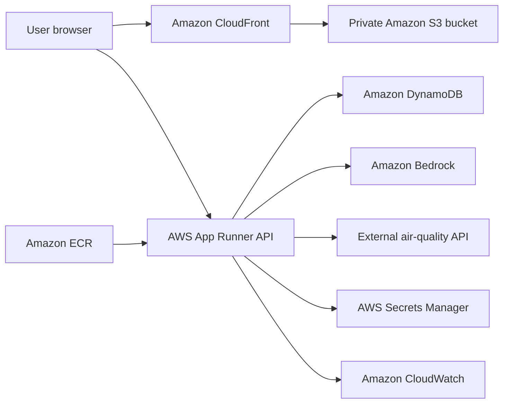

# SmogWise

A GenAI-powered assistant that helps families and communities navigate severe winter smog and urban air pollution. SmogWise recommends lower-emission daily routines, practical indoor-air improvements, and sustainable alternatives based on the user's location, household needs, and lifestyle. It also explains the estimated effect of each recommendation in plain language.

## Challenge Vertical

**Climate resilience, public health, and sustainable urban living**

The project addresses severe winter smog and urban air pollution. It focuses on practical actions that users can take without requiring specialist knowledge or expensive equipment.

## Problem Statement

During severe winter smog, families often receive generic advice that does not account for local air quality, daily schedules, health sensitivities, available transport, housing conditions, or budget. Users also struggle to understand how individual choices affect personal exposure and local emissions.

SmogWise converts air-quality and lifestyle context into a safe, realistic daily plan. It helps users:

- Reduce exposure during high-pollution hours.
- Replace high-emission activities with cleaner alternatives.
- Improve indoor air quality using affordable measures.
- Protect children, older adults, pregnant people, and people with respiratory or cardiovascular conditions.
- Understand the expected impact and trade-offs of each action.

> SmogWise provides general environmental-health guidance and is not a substitute for medical advice. Users with symptoms or existing health conditions should follow local health-authority guidance and consult a qualified clinician.

## Core Features

### Location-aware air-quality guidance

- Uses the user's permission-based location or a manually entered city.
- Retrieves current AQI, major pollutants, weather conditions, and available forecasts.
- Shows the data source and the time at which the reading was updated.
- Never asks the language model to invent live AQI values.

### Personalized daily routines

Recommendations consider:

- Commute method and schedule.
- School and work timings.
- Outdoor exercise habits.
- Household size and age groups.
- Respiratory or cardiovascular sensitivity.
- Cooking and heating methods.
- Budget and access to air purifiers or public transport.

Example suggestions include changing outdoor activity times, choosing lower-traffic routes, combining errands, using public transport or carpooling, avoiding waste burning, and ventilating the home when outdoor pollution is lower.

### Indoor air-quality assistance

- Ventilation timing based on outdoor conditions.
- Kitchen exhaust and clean-cooking suggestions.
- Guidance for reducing indoor smoke, dust, incense, and candle use.
- Affordable filtration and purifier-maintenance tips.
- Room-priority advice when the household has limited filtration capacity.

### Impact explanations

Each suggestion explains:

- **What to do**
- **Why it is recommended**
- **Expected personal benefit**, such as lower exposure
- **Expected community benefit**, such as fewer vehicle emissions
- **Cost and effort level**
- **Confidence and data limitations**

Impact statements use rule-based calculations or cited reference factors where possible. The interface labels estimates clearly and avoids presenting them as exact measurements.

### Community mode

- Reusable clean-air checklists for schools, housing societies, and neighborhood groups.
- Community actions such as no-idling zones, shared transport, dust reporting, and safe communication during pollution peaks.
- Shareable summaries that exclude private household and health information.

## Approach and Decision Logic

SmogWise uses a hybrid approach so that safety does not depend only on a language model.

1. The user provides location and optional lifestyle preferences.
2. The backend retrieves current air-quality data from a trusted external provider.
3. A deterministic rules engine assigns a risk band using pollutant values and local AQI guidance.
4. The rules engine creates safety constraints for the user's risk group.
5. Amazon Bedrock generates a clear, personalized plan using only the supplied context and approved recommendation catalogue.
6. The backend validates the generated response against a structured schema and safety rules.
7. The UI displays recommendations, source timestamps, reasons, estimated impact, and uncertainty.

### Example decision rules

- If pollution is severe, avoid recommending strenuous outdoor exercise.
- If the user belongs to a sensitive group, apply stricter exposure thresholds.
- If indoor cooking produces smoke, prioritize exhaust ventilation and cleaner cooking methods.
- If the user cannot change commute time, suggest a lower-exposure route and a well-fitted protective mask where local guidance supports it.
- If live data is unavailable or stale, state that clearly and provide only general precautions.

## Responsible GenAI Design

- Live environmental facts come from APIs, not model memory.
- The model receives the minimum context required for a recommendation.
- Structured outputs are validated before they reach the user.
- High-risk health advice is controlled by deterministic rules.
- Prompt-injection-like text from external data is treated only as data.
- The app does not diagnose disease or recommend medication.
- User location and health preferences are optional and collected with clear consent.
- Sensitive data is not written to application logs.
- Stored profiles can be viewed and deleted by the user.

## Technology Stack

| Layer | Technology | Purpose |
|---|---|---|
| Frontend | React, TypeScript, Vite | Accessible responsive web application |
| Styling | CSS Modules or Tailwind CSS | Consistent responsive UI |
| Backend | Node.js, TypeScript, Express | API, validation, recommendation orchestration |
| Validation | Zod | Request and model-output schema validation |
| GenAI | Amazon Bedrock | Personalized explanations and routines |
| Database | Amazon DynamoDB | User preferences, saved plans, and cached summaries |
| Air-quality data | Trusted third-party AQI API | Current pollutant readings and forecasts |
| Frontend hosting | Amazon S3 | Stores the production React build |
| Content delivery | Amazon CloudFront | Delivers the frontend over HTTPS and caches static assets |
| Backend hosting | AWS App Runner | Runs and scales the Node.js API |
| Container registry | Amazon ECR | Stores the backend container image for App Runner |
| Monitoring | Amazon CloudWatch | Application logs, metrics, dashboards, and alarms |
| Testing | Vitest, React Testing Library, Supertest | Unit, component, and API tests |
| CI/CD | GitHub Actions | Linting, tests, builds, and deployments |

## AWS Architecture



### AWS services needed for the MVP

1. **Amazon S3**  
   CloudFront distributes the frontend, but S3 stores the compiled React files. Keep the bucket private and allow access only through CloudFront Origin Access Control.

2. **Amazon CloudFront**  
   Provides HTTPS, caching, compression, and global delivery for the frontend.

3. **AWS App Runner**  
   Deploys and automatically scales the Node.js backend. Configure health checks and an App Runner instance role with only the DynamoDB, Bedrock, Secrets Manager, and CloudWatch permissions the application needs.

4. **Amazon ECR**  
   Stores the backend Docker image consumed by App Runner. This is needed when using App Runner's container-image deployment option.

5. **Amazon DynamoDB**  
   Stores consented user preferences, saved recommendations, and optional short-lived AQI cache entries. Enable point-in-time recovery for production data.

6. **Amazon Bedrock**  
   Generates personalized routines and plain-language explanations. Model access must be enabled in the selected AWS Region.

7. **AWS Identity and Access Management (IAM)**  
   Provides least-privilege roles for App Runner, CI/CD, S3 deployment, DynamoDB access, and Bedrock invocation.

8. **Amazon CloudWatch**  
   Collects backend logs and metrics. Configure alarms for elevated error rates, latency, and App Runner failures.

9. **AWS Secrets Manager**  
   Stores the external air-quality API key and other server-side secrets. No secret should be included in React code, source control, or logs.

### Recommended production services

- **AWS Certificate Manager (ACM):** Free managed TLS certificate for a custom domain used by CloudFront.
- **Amazon Route 53:** DNS management for the frontend and API domains.
- **AWS WAF:** Rate limiting and protection from common web attacks. Attach it to CloudFront.
- **Amazon Cognito:** Add only if user accounts, cross-device profiles, or private saved plans are required.
- **AWS CloudTrail:** Audit AWS account and API activity.
- **AWS Budgets:** Cost alerts for Bedrock, App Runner, DynamoDB, and data transfer.

### Optional services for later versions

- **Amazon Location Service:** Geocoding when users enter an address or locality. Browser geolocation is sufficient when only coordinates are needed.
- **Amazon EventBridge and AWS Lambda:** Periodically refresh shared AQI cache entries or send scheduled pollution alerts.
- **Amazon SNS:** Opt-in SMS or email alerts. Obtain explicit consent and provide an unsubscribe mechanism.
- **Amazon API Gateway:** Useful when the project needs centralized API quotas, API keys, or additional gateway controls. It is not required for the MVP because App Runner already exposes an HTTPS endpoint.

## Suggested DynamoDB Design

Use a single table with partition and sort keys where practical.

| Entity | Partition key | Sort key | Notes |
|---|---|---|---|
| User preferences | `USER#<userId>` | `PROFILE` | Store only consented fields |
| Saved plan | `USER#<userId>` | `PLAN#<timestamp>` | Add retention or deletion controls |
| AQI cache | `LOCATION#<geohash>` | `AQI#<timestamp>` | Use DynamoDB TTL for expiry |
| Community checklist | `COMMUNITY#<id>` | `CHECKLIST#<id>` | Exclude private health information |

## API Outline

| Method | Endpoint | Purpose |
|---|---|---|
| `GET` | `/health` | App Runner health check |
| `GET` | `/api/air-quality` | Return normalized AQI and source metadata |
| `POST` | `/api/recommendations` | Generate a personalized, validated daily plan |
| `GET` | `/api/plans` | List a signed-in user's saved plans |
| `DELETE` | `/api/plans/:id` | Delete a saved plan |

All write endpoints should validate input, limit payload size, enforce rate limits, and require authentication when user accounts are enabled.

## Security Measures

- Keep S3 private and use CloudFront Origin Access Control.
- Store secrets in Secrets Manager and rotate them when supported.
- Give the App Runner instance role only the required resource actions.
- Encrypt traffic with HTTPS and data at rest with AWS-managed encryption or customer-managed KMS keys where required.
- Restrict CORS to the deployed frontend origin.
- Validate and normalize every API request.
- Apply request-size limits and rate limiting.
- Redact precise locations, health preferences, tokens, and API keys from logs.
- Pin dependencies, run dependency scanning, and keep the base container image updated.
- Avoid storing exact coordinates unless the feature requires them and the user consents.

## Accessibility

- Meet WCAG 2.2 AA color contrast targets.
- Do not communicate AQI severity through color alone; include text and icons.
- Support keyboard navigation and visible focus states.
- Use semantic HTML, descriptive labels, and screen-reader announcements for updated AQI results.
- Respect reduced-motion preferences.
- Use plain language and support scalable text.
- Provide loading, empty, stale-data, offline, and error states.

## Efficiency

- Cache static frontend assets through CloudFront using content-hashed filenames.
- Cache location-level AQI results briefly to reduce external API calls while preserving freshness.
- Use DynamoDB on-demand capacity for an early-stage, unpredictable workload.
- Limit Bedrock prompt size and request structured JSON output.
- Generate a new AI response only when relevant context changes.
- Set API timeouts and retries with exponential backoff for transient upstream failures.

## Testing Strategy

- **Unit tests:** AQI normalization, risk bands, recommendation rules, impact calculations, and input schemas.
- **Component tests:** Forms, AQI status, recommendations, keyboard interactions, and error states.
- **API integration tests:** Valid and invalid requests, stale upstream data, Bedrock failures, and authorization.
- **Accessibility tests:** Automated checks with axe plus manual keyboard and screen-reader testing.
- **Security tests:** Secret scanning, dependency scanning, CORS checks, rate-limit checks, and authorization tests.
- **End-to-end tests:** Location selection through recommendation display and plan deletion.

## Assumptions

- The user explicitly permits location access or enters a city manually.
- The selected air-quality provider legally permits the intended usage and caching behavior.
- AQI scales differ by country, so the backend preserves the source scale and labels it clearly.
- Emission and exposure effects are estimates unless measured by a verified device or source.
- The first release is a web application and requires an internet connection for live recommendations.
- Authentication is optional for anonymous use and required only for private saved data.

## Three-Phase Implementation Plan

### Phase 1: Product Foundation and Local MVP

**Goal:** Build a complete local user journey before deploying it to AWS.

#### Planning and design

- [ ] Finalize the target users, supported locations, and AQI standard.
- [ ] Select an air-quality data provider and confirm its usage and caching terms.
- [ ] Define the recommendation catalogue, risk bands, safety rules, and impact factors.
- [ ] Create accessible wireframes for mobile and desktop layouts.
- [ ] Define API contracts and structured GenAI response schemas.

#### Frontend

- [ ] Create the React, TypeScript, and Vite application.
- [ ] Build location permission and manual city-selection flows.
- [ ] Build the lifestyle and household-preferences form.
- [ ] Display AQI, pollutants, data source, update time, and stale-data warnings.
- [ ] Build recommendation cards showing action, reason, impact, cost, effort, and confidence.
- [ ] Add loading, empty, offline, validation, and error states.
- [ ] Implement semantic HTML, keyboard support, visible focus, and non-color AQI labels.

#### Backend and GenAI

- [ ] Create the Node.js, TypeScript, and Express API.
- [ ] Implement `/health`, `/api/air-quality`, and `/api/recommendations`.
- [ ] Validate requests and responses with Zod.
- [ ] Normalize external air-quality data without asking the model to invent live values.
- [ ] Implement deterministic AQI risk and sensitive-group safety rules.
- [ ] Integrate Amazon Bedrock for personalized plans and explanations.
- [ ] Validate Bedrock's structured output and provide a safe fallback response.
- [ ] Add timeouts, limited retries, payload limits, and safe error handling.

#### Data and initial testing

- [ ] Define DynamoDB keys, indexes, retention rules, and TTL fields.
- [ ] Keep secrets in local environment variables that are excluded from Git.
- [ ] Write unit tests for AQI normalization, risk bands, safety rules, and validation.
- [ ] Write component tests for forms, AQI displays, recommendations, and errors.
- [ ] Write API tests for valid requests, invalid input, unavailable data, and model failures.
- [ ] Add linting, formatting, type checking, and test scripts.

**Phase 1 deliverable:** A tested local MVP that turns real or safely mocked AQI data and user preferences into a validated daily clean-air plan.

### Phase 2: AWS Infrastructure, Deployment, and Security

**Goal:** Deploy a secure, observable production version on AWS.

#### AWS resources

- [ ] Create DynamoDB tables with encryption, TTL, and point-in-time recovery as needed.
- [ ] Enable access to the selected Amazon Bedrock model in the deployment Region.
- [ ] Store the external AQI API key in AWS Secrets Manager.
- [ ] Create least-privilege IAM deployment and App Runner instance roles.
- [ ] Create an Amazon ECR repository for the backend image.
- [ ] Create a private S3 bucket for the React production build.
- [ ] Create a CloudFront distribution with S3 Origin Access Control.
- [ ] Configure CloudWatch logs, metrics, dashboards, and alarms.
- [ ] Configure AWS Budgets and cost notifications.

#### Backend deployment

- [ ] Create a small, production-safe Docker image for the Node.js API.
- [ ] Build, test, scan, and push the image to Amazon ECR.
- [ ] Deploy the image through AWS App Runner.
- [ ] Configure the App Runner health check and automatic deployments.
- [ ] Provide secrets and environment configuration without exposing values.
- [ ] Restrict CORS to the deployed CloudFront frontend origin.
- [ ] Verify DynamoDB, Bedrock, Secrets Manager, and CloudWatch permissions.

#### Frontend deployment

- [ ] Build the React application with the production API URL.
- [ ] Upload content-hashed static files to the private S3 bucket.
- [ ] Serve the application through CloudFront over HTTPS.
- [ ] Configure the single-page application fallback without masking real asset errors.
- [ ] Add an ACM certificate and Route 53 records if a custom domain is used.
- [ ] Add AWS WAF rate-based and managed rules if the budget permits.

#### Automation and deployment verification

- [ ] Add GitHub Actions for linting, type checking, tests, builds, and deployments.
- [ ] Use GitHub OIDC for AWS deployment instead of long-lived AWS access keys.
- [ ] Run deployed API integration tests and frontend smoke tests.
- [ ] Verify HTTPS, CORS, cache headers, security headers, error handling, and log redaction.
- [ ] Confirm that no API key, token, precise location, or health preference appears in client code or logs.

**Phase 2 deliverable:** A secure public application with React delivered by S3 and CloudFront, Node.js running in App Runner, and data and GenAI features connected to DynamoDB and Bedrock.

### Phase 3: Product Polish, Validation, and Submission

**Goal:** Improve practical usefulness, verify evaluation criteria, and prepare the final submission.

#### Feature completion

- [ ] Add saved plans and user-controlled deletion.
- [ ] Add Amazon Cognito only if private accounts or cross-device profiles are required.
- [ ] Add community checklists that contain no private household or health data.
- [ ] Refine low-emission routines, indoor air-quality guidance, and sustainable alternatives.
- [ ] Show the method, source, and uncertainty behind impact estimates.
- [ ] Add general guidance for stale or unavailable live AQI data.
- [ ] Add optional localization and plain-language content where time permits.

#### Quality and optimization

- [ ] Complete end-to-end tests for location selection, plan generation, saving, and deletion.
- [ ] Test with children, older adults, and respiratory-sensitive profile scenarios.
- [ ] Run automated accessibility checks and manual keyboard and screen-reader testing.
- [ ] Test mobile layouts, slow connections, empty states, upstream failures, and unsupported locations.
- [ ] Run dependency, container, and secret scans.
- [ ] Verify authorization, input limits, rate limits, CORS, and data-deletion behavior.
- [ ] Improve CloudFront caching, DynamoDB TTL usage, AQI cache freshness, and Bedrock prompt size.
- [ ] Review CloudWatch alarms, AWS costs, application latency, and failure rates.

#### Documentation and submission

- [ ] Add verified local setup, environment variable, test, build, and deployment instructions.
- [ ] Document architecture, API endpoints, assumptions, data sources, safety limits, and known limitations.
- [ ] Add screenshots and a concise application walkthrough.
- [ ] Record the demonstration video and publish it as unlisted or grant public Drive access.
- [ ] Confirm that the GitHub repository is public and contains only one branch.
- [ ] Remove generated files and other unnecessary content so the repository remains below 10 MB.
- [ ] Perform a final production smoke test using a new browser session.
- [ ] Submit the public repository link only after every checklist item is verified.

**Phase 3 deliverable:** An accessible, tested, documented, and submission-ready application that meets the challenge's code quality, security, efficiency, testing, accessibility, and problem-alignment criteria.

## Repository Structure

```text
.
├── frontend/             # React application
├── backend/              # Node.js API
├── infrastructure/       # Infrastructure-as-code templates
├── docs/                 # Architecture and supporting documentation
├── .github/workflows/    # CI/CD workflows
├── README.md
└── LICENSE
```

## Submission Checklist

- [ ] The GitHub repository is public.
- [ ] The repository contains only one branch.
- [ ] The complete repository is smaller than 10 MB.
- [ ] The README explains the vertical, approach, logic, operation, and assumptions.
- [ ] Setup, test, and deployment instructions are verified.
- [ ] No credentials, tokens, personal information, or `.env` files are committed.
- [ ] The application includes tests and accessibility checks.
- [ ] The video is unlisted on YouTube or shared through a publicly accessible Drive link.
- [ ] The public GitHub repository URL is submitted within the allowed three attempts.
