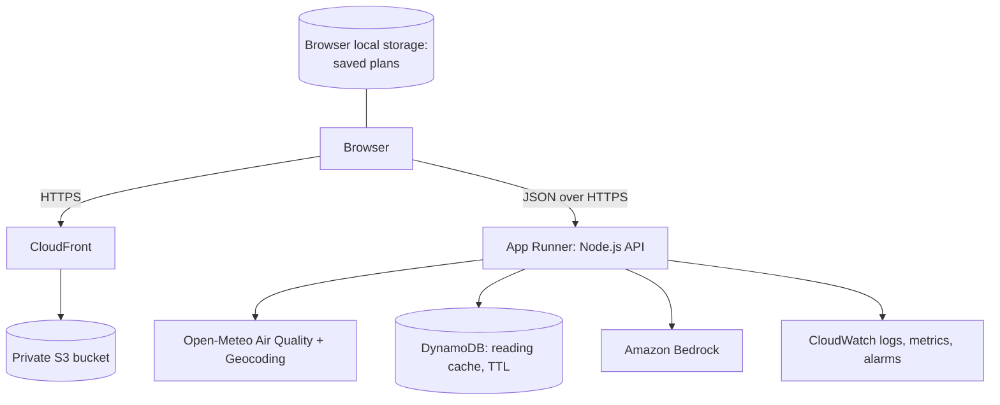
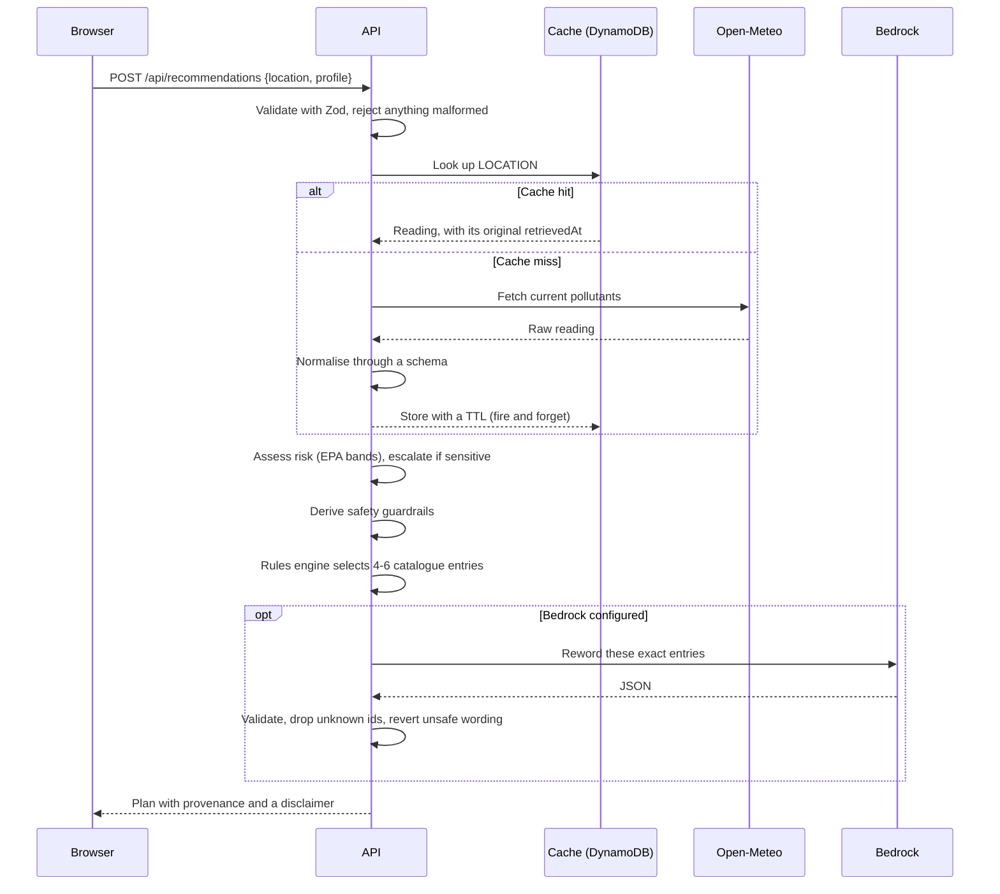

# Architecture

## System shape



Two things are worth noting on this diagram. Saved plans sit in the browser, not in DynamoDB. And DynamoDB holds only a coarse-grained air-quality cache, so the database contains no personal data at all.

## Request flow for a plan



## The central design decision

**The model never decides what advice to give.**

| Stage | Owner | Why |
|---|---|---|
| Which pollutants matter | Open-Meteo, normalised in code | Facts come from a cited source, never model memory |
| What band the air is in | [`domain/aqi.ts`](../backend/src/domain/aqi.ts) | EPA breakpoints, reproducible and reviewable |
| How strict to be | [`domain/risk.ts`](../backend/src/domain/risk.ts) | A health decision belongs in code, not in a prompt |
| Which advice applies | [`domain/recommend.ts`](../backend/src/domain/recommend.ts) | Selection is testable across every household shape |
| How it is worded | Bedrock, optional | The only thing a language model is good at here |
| Whether the wording is safe | [`services/planner.ts`](../backend/src/services/planner.ts) | Generated text is validated before a user sees it |

The practical consequence: with `BEDROCK_MODEL_ID` unset the application is fully functional and reports `generatedBy: "rules"`. A model outage changes the register of the prose, not the correctness of the advice.

### What stops the model going off-script

1. **Fixed id set.** The model receives the selected catalogue entries and may only return those ids. Anything else is discarded in `mergePlan`.
2. **Code owns the metadata.** Category, cost, effort, and confidence are never taken from the model, so it cannot relabel an expensive action as free.
3. **Phrase check.** When the band forbids outdoor exertion, generated text matching an encouragement pattern is replaced with the reviewed catalogue text, field by field.
4. **Length caps.** Every string is bounded by the Zod schema, so a runaway response cannot flood the interface.
5. **Untrusted input is fenced.** The user-supplied location name is wrapped in a delimiter with an explicit instruction to treat it as data.

The phrase check is defence in depth, not the primary guarantee. The primary guarantee is structural: the model cannot add a recommendation, only rewrite one.

## Two risk levels, both reported

`assessRisk` returns two bands:

- `level` is the officially published EPA band for the measured value. Always truthful.
- `effectiveLevel` is one band stricter when the household includes a child, an adult over 65, someone pregnant, or someone with a diagnosed heart or lung condition.

Recommendations follow `effectiveLevel`. The interface shows both and explains the gap, so a raised precaution is never mistaken for worse measured air. The community checklist publishes `level` only, because `effectiveLevel` would imply a health detail about the household.

## Caching

The cache exists for efficiency, and its key doubles as a privacy boundary.

| Property | Value | Reason |
|---|---|---|
| Key | `LOCATION#<lat>,<lon>` at 2 decimal places | A roughly 1 km grid cell. Nearby requests share an entry, and the key is coarser than the coordinates the browser sends. |
| Contents | Pollutant values and the source record | No user id, no household data, no health answers |
| Lifetime | 600 seconds, configurable | Provider readings update hourly, so this costs no freshness |
| Expiry | DynamoDB TTL, plus a check on read | DynamoDB deletes lazily, so an expired item can still be returned |
| Failure | Logged and ignored | A cache outage must degrade to a direct upstream call, never to a user-facing error |
| Fallback | Bounded in-process `Map` | Local development needs no AWS account |

`source.retrievedAt` always reports when the data was actually fetched upstream, so a cached response states its own age rather than claiming to be fresh.

## Where data lives

| Data | Location | Lifetime |
|---|---|---|
| Air-quality readings | DynamoDB, keyed by grid cell | 10 minutes, TTL |
| Household profile | React state only | The page session |
| Saved plans | Browser local storage | Until the user deletes them |
| Precise coordinates | Nowhere | Rounded to 3 decimals in the browser before use, to 2 for the cache key |
| Health answers | Never persisted, never logged | — |

There is no user account, no session, and no analytics. That is a deliberate choice rather than an unfinished feature: the application is useful anonymously, so adding Cognito would introduce an attack surface and a store of health-adjacent data for no user benefit.

## Frontend structure

Routing splits a marketing surface from the tool:

| Route | Component | Purpose |
|---|---|---|
| `/` | `LandingPage` | Explains the problem, the method, and the safety model. Fetches one live reading for credibility. |
| `/dashboard` | `DashboardPage` | Location, household, plan, save, and community checklist |
| `*` | `NotFoundPage` | Recovery link into the dashboard |

### State invalidation by derivation

Fetched results are stored tagged with the location they describe:

```ts
interface Resolved<T> { location: LocationInput; data: T | null; error: string | null }
```

What to display is then derived during render by comparing the tag against the current location. Changing city invalidates the old reading and plan without a cascade of `setState` calls, so stale data for a previous city cannot appear on screen. The `react-hooks` ESLint rules enforce this by rejecting synchronous `setState` inside an effect.

## Error handling

Only `AppError` messages reach a client. Anything unexpected is logged by name and returned as a generic failure, which a test asserts by checking that a thrown connection string does not appear in the response.

| Condition | Status | Behaviour |
|---|---|---|
| Invalid input | 400 | Specific, user-safe validation message |
| Disallowed CORS origin | 403 | A client policy failure, kept out of the 5xx alarm |
| Oversized body | 413 | Explicit, not a 500 |
| Rate limit | 429 | Retry guidance |
| Upstream down or slow | 503 | "Try again" wording, no internal detail |
| Anything else | 500 | Generic message, logged by error name only |
| No usable reading | 200 | Band reported as `Unknown` with precautionary advice, never a guess |

## Accessibility approach

Severity is carried by text in every case. The band name, a dot glyph, and the health advice are all real text; the colour border and the scale bar are decorative and hidden from assistive technology. Progress through the three dashboard steps is stated as "Done", "Current step", or "To do" alongside `aria-current="step"`.

See [`frontend/README.md`](../frontend/README.md) for the full list and the one gap: axe cannot check colour contrast under jsdom.
